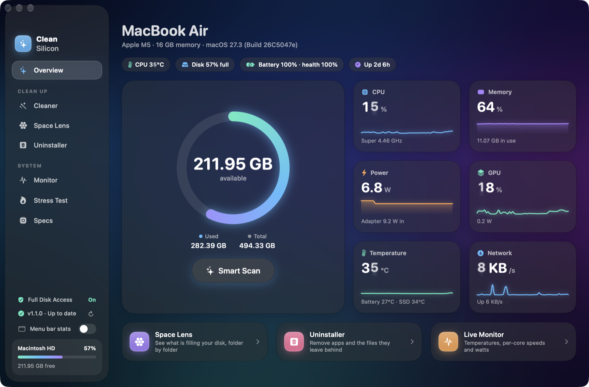
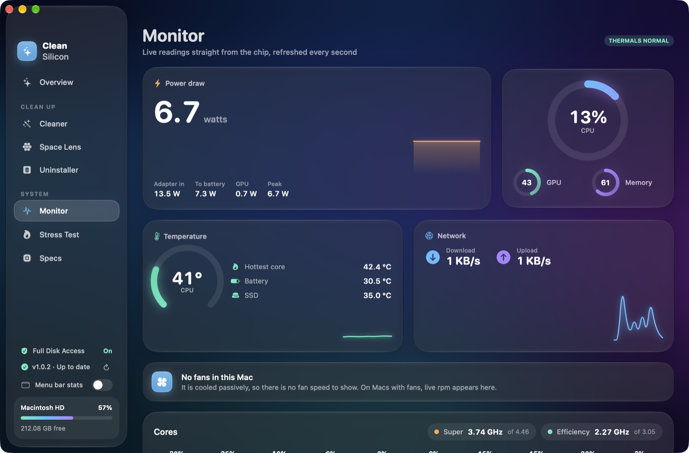
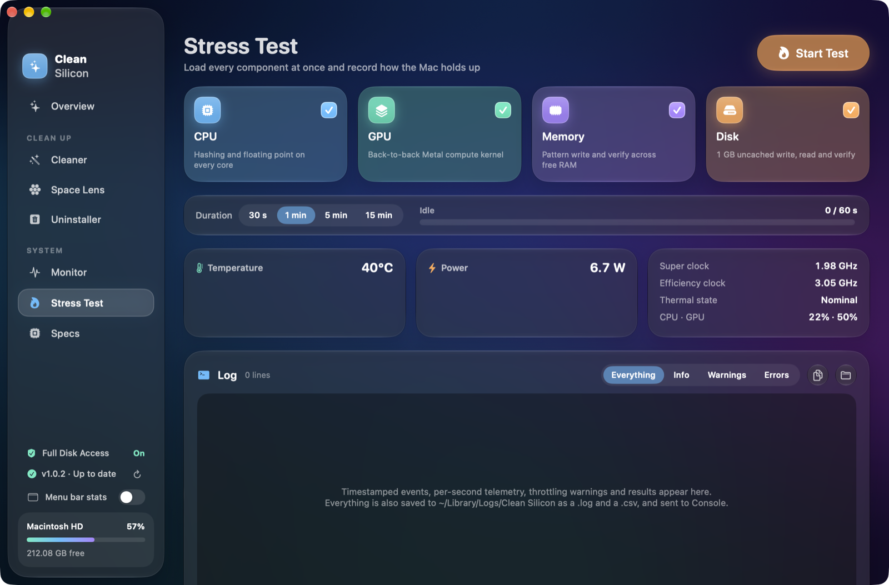
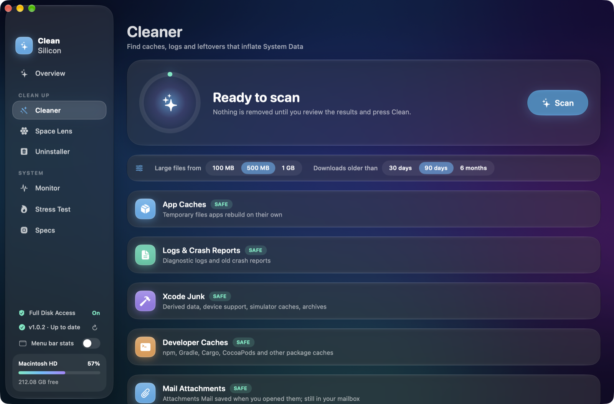

# Clean Silicon

A native macOS app for Apple silicon Macs that frees disk space and shows what the machine is doing, built with SwiftUI and Liquid Glass.



## What it does

- **Cleaner**: finds caches, logs, Xcode and developer leftovers, iOS backups, old installers, simulators, duplicates and large files, and lets you choose what goes.
- **Space Lens**: a treemap of any folder, where bigger blocks are bigger folders and each block shows what is inside it. Click to zoom in, and move items to the Trash.
- **Uninstaller**: remove an app together with its leftover files.
- **Monitor**: live CPU and GPU load, clock speeds, power in watts, temperatures, memory, network, battery and the busiest processes. Also available from the menu bar.
- **Stress Test**: load CPU, GPU, memory and disk together, with per-second telemetry, throttling warnings and a `.log` plus `.csv` for every run.
- **Specs**: everything about the hardware in one place.

| Monitor | Stress Test |
|---|---|
|  |  |



## Requirements

macOS 26 or later on Apple silicon. Full Disk Access is needed to see the whole disk; the app checks for it and walks you through granting it.

## Install

Download `CleanSilicon.zip` from the [latest release](https://github.com/SkeletonDoctor/Clean-Silicon/releases/latest), unzip it and move **Clean Silicon** to Applications. The build is not notarized, so the first time, right-click the app and choose **Open**.

After that the app keeps itself up to date: it checks GitHub for a newer release, verifies the download's signature and installs it when you restart or quit. The sidebar shows the installed version and a button to check now. To turn automatic updates off:

```sh
defaults write com.cleansilicon.app autoUpdate -bool NO
```

## Build from source

Needs Xcode 26 or later.

```sh
./Scripts/build.sh --install
```

This builds `build/Clean Silicon.app` and copies it to `/Applications`.

## Releasing

Bump `VERSION`, commit, then run `./Scripts/release.sh "Release notes"`. Releases are signed with a private key kept outside the repository (`swift Scripts/sign_update.swift keygen` creates one). If you fork the project, change `repository` and `publicKey` in `Sources/CleanSilicon/Updater.swift`.

## License

[MIT](LICENSE)
